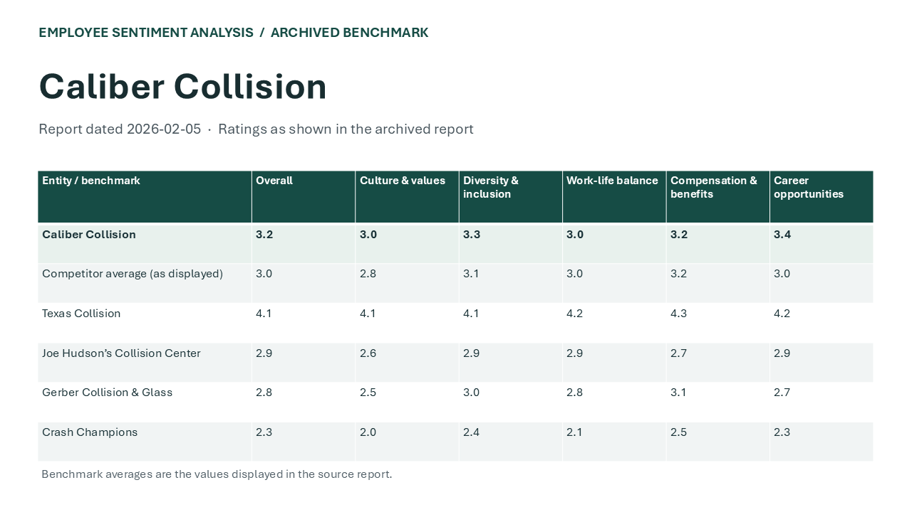

# PPTX TemplateUpdate

**Employee Sentiment Analysis project family:** [Project guide](https://github.com/MRodriguez2010/Revelio/blob/main/docs/employee-sentiment-analysis-projects.md) · [Revelio interactive demo](https://github.com/MRodriguez2010/Revelio)

Try the two generated decks in `TestFiles/`. They contain matching `slot:project` and `slot:status` anchors in different layouts.

A standalone local utility for validating and testing anchor-based PowerPoint template updates.

## Quick Start

```bash
# Install dependencies
pip install -r requirements.txt

# Run the app
python app.py
```

**Requirements:** Python 3.10+, tkinter (included with most Python installations).

## What It Does

1. Select an existing PPTX template and a new PPTX template.
2. Detect anchors in both files and auto-match them.
3. Manually adjust mappings if needed.
4. Enter test text for selected anchors.
5. Generate a test PPTX output preserving template design.

## Project Structure

```
PPTX_TemplateUpdate/
  app.py                 Entry point
  models/                Data models (AnchorRecord, AnchorMapping)
  services/              PPTX reading, anchor detection, mapping, test writing, validation
  ui/                    Tkinter UI screens
  outputs/               Generated test PPTX files
```

## Architecture

### Data Flow

```
TemplateSelection -> AnchorDetector -> AnchorResults -> AnchorMapper -> MappingView
  -> TestingView -> TestWriter -> ResultsView
```

### Anchor Detection

Anchors are detected via three methods (in priority order):
1. **Shape name** matching `slot:<key>` pattern
2. **Alt text** matching `slot:<key>` pattern (read via lxml cNvPr `descr` attribute)
3. **Visible text** matching `{{key}}` curly-brace pattern

The detector also traverses grouped shapes and table cells.

### Validation Pipeline

- **Anchor load time**: duplicate key warnings per template
- **Mapping time**: missing-pair warnings (existing-only / new-only)
- **Pre-test**: selected anchors with empty test values
- **Post-write**: readback verification (re-opens output PPTX, checks written text)

### Services Layer

All business logic lives in `services/`. Each module is stateless and can be imported independently:
- `pptx_reader.py` - low-level PPTX shape iteration (handles groups, tables, placeholders)
- `anchor_detector.py` - anchor key extraction and normalization
- `anchor_mapper.py` - auto-matching anchors by key between old/new templates
- `test_writer.py` - PPTX output generation with font-preserving text replacement
- `validation.py` - warnings and verification at each pipeline stage

## Revelio Integration Notes

This tool is designed for standalone use but its services layer can be integrated into the Revelio pipeline:

### Integration Points

1. **Anchor detection as a library call**: `detect_anchors(path)` returns `list[AnchorRecord]` and can be called from Revelio's template analysis step without any UI dependency.

2. **Mapping as a data structure**: `build_mappings(existing, new)` produces `list[AnchorMapping]` which can be serialized to JSON for Revelio's API layer. The `AnchorMapping` dataclass contains all the information needed: key, both anchor references, inclusion flag, and test value.

3. **Test writer for batch processing**: `run_test(template_path, output_path, mappings)` accepts pre-built mappings and can run headlessly. Revelio can call this directly for automated template validation without the Tkinter UI.

4. **Validation for CI/CD**: `validate_mappings()`, `validate_pre_test()`, and `verify_readback()` can be used in automated quality checks. They return plain `list[str]` warnings suitable for logging or API responses.

### Recommended Integration Pattern

```python
from services.anchor_detector import detect_anchors
from services.anchor_mapper import build_mappings
from services.test_writer import run_test, generate_output_path
from services.validation import validate_mappings, verify_readback

existing = detect_anchors("old_template.pptx")
new = detect_anchors("new_template.pptx")
mappings = build_mappings(existing, new)
warnings = validate_mappings(mappings)

# Set test values programmatically
for m in mappings:
    if m.new_anchor:
        m.include_in_test = True
        m.test_value = f"TEST_{m.anchor_key}"

output = generate_output_path("new_template.pptx", "./outputs")
result = run_test("new_template.pptx", output, mappings)
result.warnings.extend(verify_readback(output, mappings))
```

### Data Serialization

`AnchorRecord` and `AnchorMapping` are plain dataclasses. Convert to dict with `dataclasses.asdict()` for JSON serialization. Both use only primitive types (str, int, bool, list) so no custom serializers are needed.

## Current Status

**Phase 6 complete** - all core features implemented including validation pipeline, grouped shape / table cell handling, status bar, and Revelio integration documentation.

## Historical source examples

The [Caliber Collision benchmark](public-data/caliber-benchmark.pptx) and [revised example](public-data/caliber-benchmark-revised.pptx) use the February 5, 2026 comparison. They share the `slot:project` and `slot:status` anchors and retain the [archived figures](public-data/caliber-ratings.csv) in an editable table. Use them as an additional old/new pair in the migration tool.


